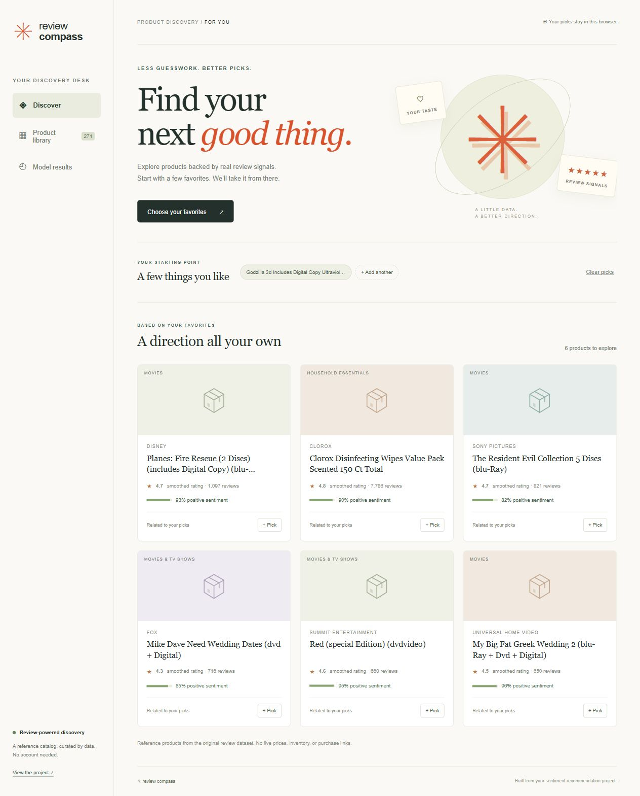

# Review Compass — Sentiment and Product Recommendations

[](https://github.com/Ashik-Mohammed-S/Sentiment_Based_Product_Recommendation_System/actions/workflows/validate.yml)

An independent recommendation project with **separate sentiment, ranking and rating evaluations**, a runnable Flask API and a browser inference app.

[Flask setup and API](APP.md) · [Model card](MODEL_CARD.md) · [Monitoring setup](MONITORING.md) · [Owner-private hosted preview](https://review-compass-ashik.swoonysnipe19.chatgpt.site)



## Problem and data

Recommend unseen products from historical review signals while handling sparse histories and cold starts. The repository contains **30,000 source reviews covering 271 products**. Current claims refer to that stored dataset; they do not assert a one-million-review benchmark or production sales impact.

## What is implemented

- **Sentiment:** normalized duplicate-review groups cannot cross the holdout. Training-only TF-IDF and class-balanced logistic regression; no pre-split vocabulary fitting or pre-CV SMOTE.
- **Ranking:** compare popularity, smoothed positive-review fractions, EASE item co-occurrence and metadata similarity on an inner validation split. Selected ranking uses popularity, sentiment and EASE; metadata weight is zero.
- **Rating:** regularized item means and user bias, with shrinkage selected on validation. This is distinct from the top-five ranking objective.
- **Serving:** a JSON artifact with product metadata and aggregate parameters. No reviewer usernames, raw review bodies or user histories are shipped to the browser. Favorites stay in browser local storage.
- **Operations:** Flask input validation, Python/browser scoring parity, CI, hourly repository-owned health checks and optional Gmail failure delivery. Gmail needs account or secret activation; workflow files alone do not prove email is active.

## Held-out results

| Measure | Current model | Baseline |
| --- | --- | --- |
| Sentiment macro-F1 | 0.812 | Majority 0.469 |
| Sentiment ROC-AUC | 0.958 | 0.500 |
| Ranking NDCG@5 | 0.46965 | Popularity 0.45644 |
| Ranking precision@5 | 0.11767 | Popularity 0.11615 |
| Rating RMSE | 0.79820 | Global mean 0.93269 |

Ranking evaluates 4,866 users with held-out positive ratings, including 4,205 cold users. Unknown relevant items remain in denominators. Selection uses the inner training split; final test results are not used to choose weights. See [the reproducible report](evaluation/recommendation.json) for candidates and split details.

The ranking improvement is modest; statistical significance was not established. Unobserved items are unjudged. A random pair split is an offline proxy, not evidence of online engagement lift. Sentiment classification is evaluated separately; ranking uses smoothed observed source sentiment labels rather than claiming online free-text sentiment inference.

## Run the Flask app

Use the Python version in `.python-version`:

```sh
python -m pip install -r requirements-web.txt
waitress-serve --host=127.0.0.1 --port=8080 app:app
```

Open http://127.0.0.1:8080. Choose products, inspect changed recommendations and review the evaluation page. The hosted Sites edition performs browser inference; it does not host the Flask process. The owner-private preview may require access, so local setup is the reproducible review path.

## Reproduce the analysis

```sh
python -m pip install -r requirements.txt -r requirements-web.txt
python scripts/fetch_data.py
python scripts/run_notebook.py --mode full
python -m unittest discover -s tests
python scripts/check_web.py
```

The parity check needs Node. Data is committed in `dataset/` and verified by checksum. [DATA.md](DATA.md) and [dataset-sources.json](dataset-sources.json) retain provenance and upstream terms. Earlier academic approaches and saved models are historical reference, not the current evaluation or serving path.

## Limitations and reviewer guide

No live prices, inventory, purchasing integration, A/B test or production deployment of Flask is claimed. Inspect [scripts/recommender.py](scripts/recommender.py), [serving.py](serving.py), the [model card](MODEL_CARD.md), and one cold-start case before drawing conclusions from aggregate metrics.

[Portfolio index](https://github.com/Ashik-Mohammed-S/Ashik-Mohammed-S/blob/main/PORTFOLIO.md)
